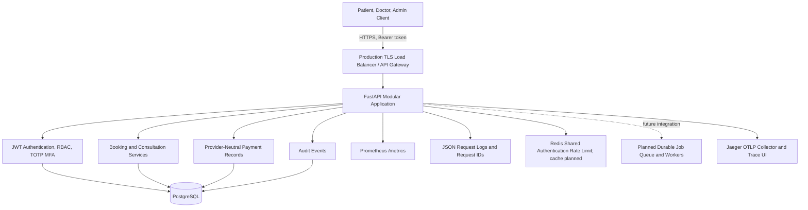
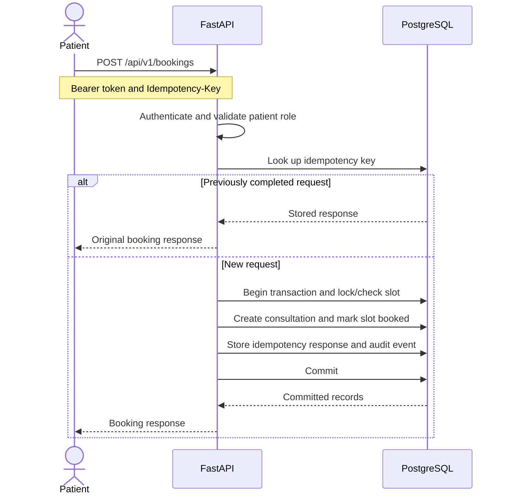
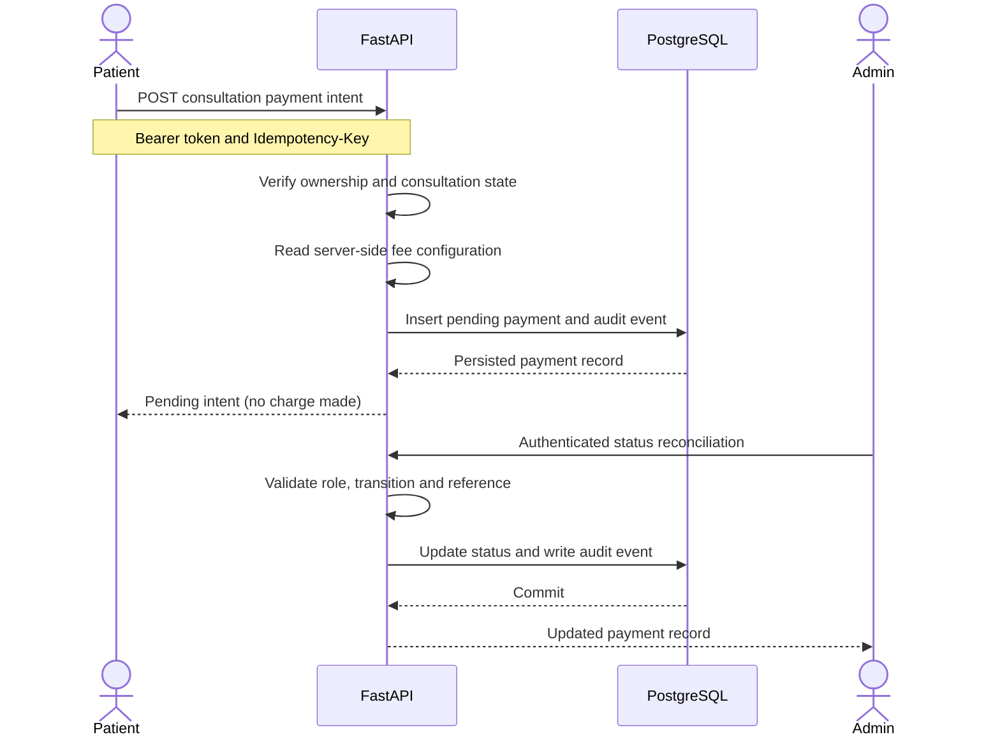
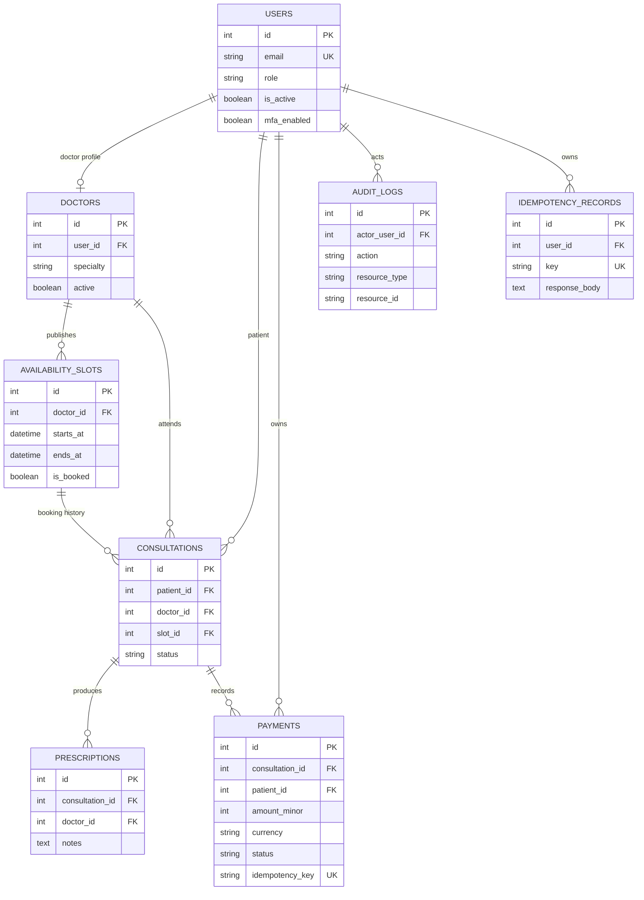

# Amrutam Telemedicine Backend — Architecture

## 1. Scope and architecture decisions

The application is a modular monolith built with FastAPI, SQLAlchemy, Alembic, and PostgreSQL. Modules cover authentication, doctor directory and availability, consultation booking and lifecycle, prescriptions, payment records, audit events, and administrative analytics.

A modular monolith is appropriate for the current assignment because it keeps deployment and transaction management simple while allowing service boundaries to be introduced later if measured load or team ownership justifies them.

The assignment target is 100,000 consultations per day, read p95 below 200 ms, write p95 below 500 ms, and 99.95% availability. These are design targets, not verified performance or availability results. Load testing and production deployment evidence are still required.

## 2. High-level architecture and data flow

The local Docker Compose stack runs FastAPI, PostgreSQL, Redis, and Jaeger. Redis provides shared IP-based sliding-window rate limiting for the authentication endpoints; Redis caching is not enabled. The API also exposes `/health`, `/metrics`, and OpenAPI endpoints at `/openapi.json` and `/docs`. Request logs are structured JSON and include request IDs. Prometheus counters and latency histograms are exposed at `/metrics`. When running under Compose, OpenTelemetry exports FastAPI request and SQLAlchemy database spans over OTLP/HTTP to Jaeger, available at `http://localhost:16686`. A production metrics backend, alerting policy, trace retention, and production-grade collection deployment still need to be designed and operated.

## 3. Booking sequence and transaction boundaries

Booking is implemented as a database transaction. PostgreSQL row locking serializes competing access where supported, while database uniqueness constraints provide additional protection against duplicate active bookings. Cancelled consultations remain in history and release their slots for rebooking. The booking endpoint requires an `Idempotency-Key`.

A repeated key from the same patient returns the stored response; a key owned by another patient is rejected. Production hardening should also persist a canonical request fingerprint and retention policy for idempotency records. SQLite is useful for isolated automated tests, but it does not offer equivalent row-locking behavior to PostgreSQL.

Audit events are written in the business transaction where the workflow supports it. A production outbox and durable worker should be introduced before integrating external notification, video, or payment services.

## 4. Payment-intent flow

The `payments` table stores amounts in minor currency units (paise), currency, status, provider label, optional provider reference, idempotency key, and timestamps. The default demo fee is 50,000 paise (INR 500.00), configurable through `AMRUTAM_CONSULTATION_FEE_MINOR`. The patient cannot supply the amount.

Payment creation is provider-neutral and does not transfer money. Manual status reconciliation is restricted to administrators, validates transitions, and creates audit records. A real gateway adapter, verified signed webhooks, settlement and refund execution, provider-side idempotency, and reconciliation against provider statements are not implemented.

## 5. Entity relationships

Cancelled consultations and historical payment attempts may be retained, so the relationship between a slot and its consultation history is one-to-many. Partial unique indexes restrict active bookings per slot and active payment records per consultation. The ER diagram describes logical relationships; the database constraints remain authoritative.

## 6. API contract

FastAPI generates an OpenAPI schema from route and Pydantic definitions. The interactive API reference is available at `/docs`, and the machine-readable schema is available at `/openapi.json`.

Important route groups include:

- Authentication: registration, login, current user, MFA enrollment/enable/disable.
- Doctors and availability: directory search and slot management.
- Bookings and consultations: idempotent booking, status transitions and prescriptions.
- Payments: create intent, retrieve own payment, and admin-only manual reconciliation.
- Administration: analytics and audit-log access.

Protected routes use signed expiring JWT access tokens and role/ownership checks. Public registration creates patient accounts only; doctor and administrator accounts must be provisioned through a trusted process.

## 7. Reliability, concurrency and retry policy

Database transactions and uniqueness constraints protect the critical booking path. Payment-intent creation also uses idempotency keys and a database constraint to handle duplicate active records. Status transitions are validated before mutation.

Retry policy must distinguish transient infrastructure failures from business conflicts. In a production deployment, retry safe operations only, with bounded exponential backoff and jitter. Do not blindly retry writes unless their idempotency semantics are guaranteed. Deadlock and serialization retries, timeouts, connection-pool limits, and conflict-rate monitoring require further implementation and validation.

Do not hold a database transaction open while waiting for an external payment, notification, or video provider. For distributed workflows, use an outbox, idempotent consumers, bounded retries, and a defined compensation/state-machine policy. These asynchronous workflows are architectural recommendations, not currently delivered workers.

## 8. Scaling, caching and partitioning

The target workload of 100,000 consultations per day averages about 1.16 consultations per second; peak traffic can be much higher. Validate the design with realistic concurrency and query distributions before claiming the latency targets have been met.

Recommended production sequence:

1. Measure query plans, request latency, connection-pool saturation, and booking conflicts under representative load.
2. Scale stateless API instances behind a load balancer and size PostgreSQL connection pools for the total replica count.
3. Redis-backed shared authentication rate limiting is implemented. Add Redis caching for carefully selected doctor-directory reads only after defining TTLs and explicit invalidation.
4. Evaluate PostgreSQL read replicas for read-heavy endpoints.
5. Consider monthly range partitioning for consultations and audit logs only when measured table growth and query patterns justify the operational cost.

Do not cache private medical records without a reviewed authorization, invalidation, and privacy design. Shared authentication rate limiting has been tested locally against Docker Redis; Redis caching, partitioning, read replicas, and production-scale load capacity have not been validated in the current demo deployment.

## 9. Security and privacy

Implemented controls include Argon2 password hashing, signed expiring JWTs, patient-only public registration, RBAC/ownership checks, TOTP MFA with encrypted secrets and recovery-code/TOTP replay protection, input validation, selected business audit events, and Redis-backed shared IP rate limiting on POST `/api/v1/auth/login`, `/api/v1/auth/token`, and `/api/v1/auth/register` (five requests per 60 seconds per endpoint and client IP). The limiter uses an atomic Redis sliding-window script; when configured Redis is unavailable, protected authentication requests fail closed with HTTP 503.

When `REDIS_URL` is not configured, development and tests may use the process-local fallback; in `APP_ENV=production`, the limiter fails closed with HTTP 503 instead of silently weakening protection. Production hardening still includes gateway/WAF protections, per-account limits, managed secret/key storage and rotation, image and secret scanning, TLS configuration at the production boundary, verified encryption-at-rest settings, PHI redaction tests, access reviews, retention policy, and a threat-model/security review.

Never log passwords, bearer tokens, recovery codes, payment secrets, or clinical notes. The demo does not establish regulatory compliance or production certification; applicable Indian privacy and healthcare obligations need review by qualified professionals before launch.

## 10. Observability and operations

Implemented observability includes JSON request logs with request IDs, Prometheus request counters and latency histograms, an application health endpoint, and OpenTelemetry distributed traces. The local Compose deployment sends FastAPI and SQLAlchemy spans to Jaeger. A real `GET /api/v1/doctors` trace has been verified with HTTP, connection, and SQL query spans. Production readiness still requires a metrics backend, alerts, retained traces, database-aware readiness, and dashboards for request rate, error rate, latency, connection-pool pressure, booking conflicts, authentication failures, and queue lag.

The repository's CI workflow installs dependencies, compiles Python files, runs automated tests, and audits Python dependencies. PostgreSQL migration integration tests run in CI. Container image scanning, secret scanning, and deployment approvals remain outstanding.

## 11. Availability, backup and disaster recovery

The 99.95% availability target permits approximately 21.6 minutes of downtime in a 30-day month. The local Compose stack is not evidence that this target is met.

Production readiness requires a defined recovery-point objective (RPO) and recovery-time objective (RTO), encrypted automated backups, point-in-time recovery, separately protected backup copies, regular restore drills, database monitoring, and a tested regional recovery plan. Multi-zone application and database deployment plus failover behavior must be validated in the target environment. The current repository has not established tested disaster recovery or measured production availability.

## 12. Implementation status summary

| Capability | Current status |
|---|---|
| FastAPI, PostgreSQL and Alembic | Implemented |
| Authentication, roles, TOTP MFA | Implemented and tested |
| Booking idempotency and slot constraints | Implemented; PostgreSQL concurrency load test needed |
| Consultation lifecycle and prescriptions | Implemented |
| Payment-intent records and admin reconciliation | Implemented; no real gateway |
| Audit events and admin analytics | Implemented |
| Request logs, Prometheus metrics, and traces | Implemented locally; production dashboards/alerts/retention needed |
| Distributed tracing | Implemented locally using OpenTelemetry and Jaeger |
| Shared authentication rate limiting | Implemented with Redis; Docker integration tested. Broader gateway controls and Redis caching remain outstanding |
| Durable asynchronous workers/outbox | Not implemented |
| Load test for target latency/throughput | Not completed |
| Automated backup restore and disaster-recovery drills | Not completed |
